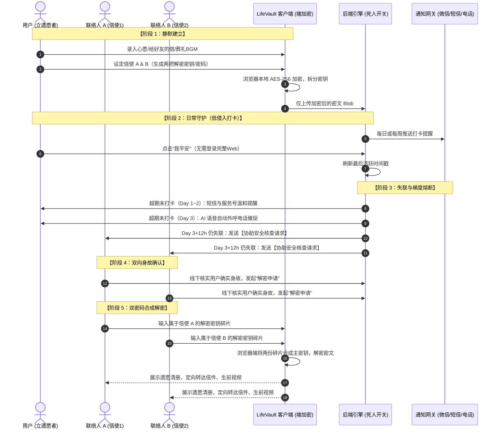

# 01. 产品设计与核心功能闭环

> 历史版本：已由 [有所托 PRD v1.0](./PRD.md) 取代。本文中的旧称呼、逐封权限、自动外呼及核验流程不作为当前开发需求。

---

## 一、 用户核心旅程与业务闭环

整个产品的生命周期分为五个关键阶段：**建立、日常守护、失联熔断、身故核验、解密转达**。

---

## 二、 核心功能模块设计

### 1. 核心档案库（The Soul Capsule）
- **生前未竟之言（定向加密信件）**：
  - 可以为不同的人写专属信件（例如“给妈妈”、“给初恋”、“给合伙人”、“给老铁”）。
  - 支持文字、录音、相册打包或一段私密视频。
- **我的告别审美（葬礼与遗愿清单）**：
  - **葬礼 BGM 歌单**：网易云/QQ音乐/Spotify 链接或本地音频文件（*“别放哀乐，请放这首歌送我”*）。
  - **仪容与着装偏好**：希望穿哪套衣服、拒绝铺张浪费、海葬/树葬偏好。
  - **宠物与数字资产处置**：家里猫狗托付给谁、社交账号注销意愿、硬盘/云盘销毁或格式化指令。
- **跨圈层亲友联络名单（Bridge of Circles）**：
  - 许多独居者的大学同学、前同事、老家发小互相完全没有联系方式。
  - 用户列出清单：“当我不在了，请信使帮我给以下 5 个人发一条短信告知，他们是我生命中重要的人，不要让他们到处找我”。

### 2. 双人信使与双密码门限系统（Dual-Key Trustee）
- 用户在设置时指定 **两名最信任的独立联系人**（例如：一位是老家亲人，一位是多年死党）。
- 系统会在用户本地生成两组独立的密码/密钥凭据（Key A 和 Key B）。
- **核心逻辑**：
  - 只有两组密码同时输入，才能解密用户留下的核心保险箱。
  - 任何一个人拿着自己的密码找平台，平台也无法解密（数学上单份无法还原）。
  - 提供 **“密码信封卡片”**：用户可选择将密钥以精美的加密二维码卡片形式下载打印，寄给对方或存放在保险柜。

### 3. 防误报梯度熔断机制（Anti-False-Positive Graduated Switch）
*为什么不能“3天没签到就直接认定死亡”？因为用户可能只是断网、旅游、住院或手机被偷。*

| 时间节点 | 状态 | 系统动作 | 心理负担控制 |
| :--- | :--- | :--- | :--- |
| **正常期 (T)** | 绿色-平安 | 微信服务号/邮件发一条极简消息，点一下“平安”即刷新 | 耗时 < 1 秒 |
| **超期 24 小时** | 黄色-轻度超时 | 微信服务号推送、发送 1 条短信到用户手机 | 仅提醒本人，不惊动亲友 |
| **超期 48 小时** | 橙色-中度超时 | 再次发送加急短信，邮件抄送 | 提示还有 24 小时将启动联络人程序 |
| **超期 72 小时** | 红色-警戒状态 | 启动**自动语音外呼电话**拨打用户手机（连打2次） | 强行唤醒用户 |
| **超期 84 小时** | 紫色-疑似失联 | **向两位信使同时发送【安全核查求助】** | **严禁提及“已身故”！** 话术：“某某已超84小时未向系统报平安，电话呼叫无应答，可能处于紧急断联或意外状态，请您协助电话或上门确认。” |
| **核验期** | 人工确认 | 两位信使在线上共同点击“已确认身故并申请开启遗愿” | 避免系统自动化决策的误判 |

---

## 三、 用户体验细节（UX & Tone）

1. **界面调性（Tone of Voice）**：
   - 绝不使用惊悚、压抑、封建迷信的黑白祭奠风。
   - 采用 **Apple / Linear 式的高级静谧美学**（深邃太空灰、暖米白、细腻微质感），传达的是**理性、庄重、体面、深情与从容**。
2. **免责与法律声明**：
   - 界面底部醒目提示：“LifeVault 属于个人生前意愿备忘与情感托付工具。涉及不动产、银行存款等法定财产继承，请遵照《中华人民共和国民法典》办理公证遗嘱。”
   - 彻底与财产继承纠纷做物理切割，保护平台自身。
