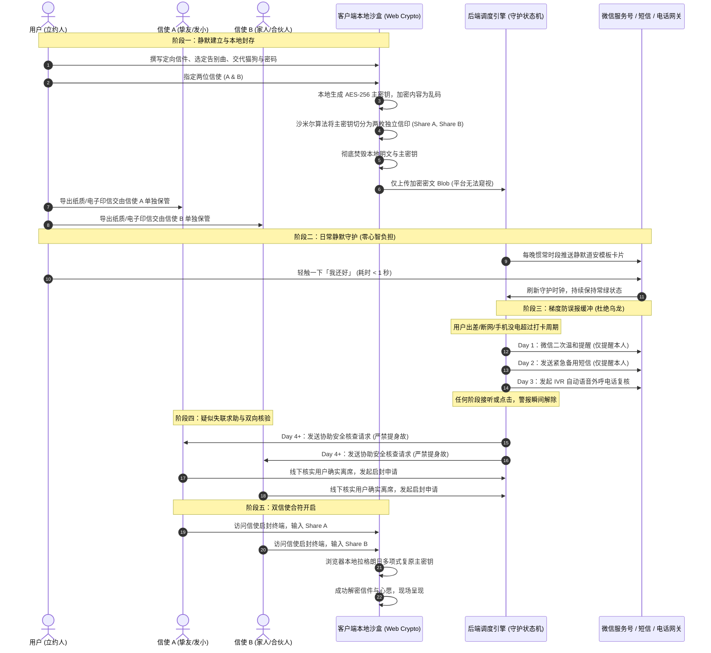

# 余温 · LifeVault

> 历史总纲：产品现名为“有所托”，当前唯一产品需求依据为 [有所托 PRD v1.0](./PRD.md)。本文保留用于追溯，旧版安全承诺、权限隔离、2-of-3、死亡核验、外呼及定价不作为当前需求或已实现能力。
## 全景商业策划、安全架构与全栈技术实施白皮书

> **“生命总有不期而遇的终章。把爱与交代，整整齐齐地放进抽屉；然后毫无挂碍地，去过好明媚的今天。”**
>
> 核心产品定位：国内首款专注于独居时代与现代人精神托付的 **“零知识加密生前信匣与微信静默守护系统”**。以数学逻辑证明隐私绝对安全，以微信服务号实现零心智负担的每日道安，以双信使门限钥匙确保身故后定向送达。

---

## 目录索引

- [第一章 项目起源与核心价值主张](#第一章-项目起源与核心价值主张)
- [第二章 用户全生命周期与产品业务闭环](#第二章-用户全生命周期与产品业务闭环)
- [第三章 核心功能模块详细设计](#第三章-核心功能模块详细设计)
- [第四章 微信服务号静默守护与交互闭环](#第四章-微信服务号静默守护与交互闭环)
- [第五章 零知识加密与密码学安全架构](#第五章-零知识加密与密码学安全架构)
- [第六章 商业变现模式与财务模型测算](#第六章-商业变现模式与财务模型测算)
- [第七章 运营获客与裂变增长策略](#第七章-运营获客与裂变增长策略)
- [第八章 全栈技术实现与工程架构](#第八章-全栈技术实现与工程架构)
- [第九章 UI/UX 视觉美学与统一字体规范](#第九章-uiux-视觉美学与统一字体规范)
- [第十章 法律合规防线与免责边界](#第十章-法律合规防线与免责边界)

---

## 第一章 项目起源与核心价值主张

### 1.1 时代命题：独居时代的“死亡与隐私焦虑”
根据第七次全国人口普查及民政部门统计，中国单身成年人口已突破 2.4 亿，独居成年人超过 9200 万。在快节奏、高压力的现代社会中，“孤独死”、“意外失联无人知晓”、“猝死后猫狗断粮”、“私密日记被误看”、“有些真心话活着不敢当面说”成为数千万人心底最深层的隐忧。

市场上曾出现过打卡类工具（如“死了吗”App），虽引发全民讨论，但存在三大致命缺陷：
1. **产品定位偏噱头与晦暗**：纯粹围绕“死亡打卡”，用户体验压抑、猎奇，难以长期留存；
2. **数据安全毫无保障**：绝大部分工具将用户隐私明文存入云端数据库，存在内部窥探、黑客拖库与泄露的巨大法律风险；
3. **缺乏交付闭环**：仅仅感知“失联”，却没有解决“失联之后怎么办、信交给谁、猫谁来养、钥匙如何交接”的核心问题。

### 1.2 LifeVault 的根本破局点
- **立意重塑**：不谈死亡噱头，谈“生命的体面交代与当下从容”。
- **安全基石**：以 **AES-256-GCM 端对端加密 + Shamir 门限多项式（2-of-2）** 实现数学上的绝对保密——**平台、黑客、单方信使，谁也看不了哪怕一个字**。
- **载体选择（Web + 微信服务号生态）**：
  - **为何不做独立 App**？让人每天专门打开一个 App 是反人性的，心智负担过重；
  - **为何不做单纯的微信小程序**？小程序受制于腾讯严苛的资质类目审查（遗嘱/备忘类目极易被封），且 iOS 虚拟支付被 100% 封锁，无法商业化变现；
  - **最优解：现代化响应式 Web 配合微信服务号**。用户平时不用开任何网页，每晚微信推送一条静默模板消息，轻触一下 1 秒报安；深度的信件撰写与解密在浏览器本地安全沙盒中完成；支付直接微信扫码，完全闭环。

---

## 第二章 用户全生命周期与产品业务闭环

整个系统涵盖五大关键生命周期：**静默建立、日常守护、阶梯防误报、身故核验、双钥合符启封**。



---

## 第三章 核心功能模块详细设计

### 3.1 核心档案库（The Soul Capsule）
1. **定向私密信件（To Specific Persons）**：
   - 用户可针对不同的人（母亲、父亲、伴侣、子女、挚友）草拟独立的信笺；
   - 每一封信独立密押，启封后按人分别呈现，避免不同圈层之间的尴尬与误会。
2. **专属谢幕心愿（My Farewell Aesthetics）**：
   - **谢幕曲目**：指定告别仪式播放的歌曲（如《Aqua》、《送别》），拒放千篇一律的哀乐；
   - **仪容与着装**：叮嘱穿平时最舒服的旧毛衣、球鞋，拒绝过度浓妆与繁文缛节；
   - **安息归宿**：海葬、树葬、骨灰撒入江河或不设墓位的心愿明确表达。
3. **毛孩子托付与数字资产清算（Legacy & Digital Footprints）**：
   - **宠物日常指南**：饮食禁忌、偏好粮款、常去医院、家中备用钥匙位置；
   - **数字遗产清单**：云盘相册彻底注销指令、社交账号不公开留存指令、个人开源代码与服务器委托归档说明。
4. **跨圈层故友定向知会名单（Cross-Circle Notification）**：
   - 老同学、前同事、网友彼此互不相识，一旦当事人离席极易失联；
   - 用户提前录入联系方式与预置短信留言，信使一键群发知会，体面告别。

### 3.2 双信使门限系统（Dual-Trustee Threshold）
- **绝不相信单点人性**：如果只交由一个人保管，存在好奇窥探、提前泄密、感情破裂报复的巨大隐患；
- **沙米尔 2-of-2 机制**：将开箱主权一分为二，建议分别托付给互不认识的两个圈子好友（如发小与工作合伙人）。单独任何一个人拿到密钥，信息论获取量绝对为 0；唯有两人同时在场输入，才能完成合符。
- **实体信印凭证卡（Printable Custodian Card）**：
  - 支持一键导出排版考究、带有高密度加密二维码的信使纸质藏书票/藏书卡；
  - 可物理打印放进信封，赠予受托人或锁在抽屉，赋予现代数字资产以庄重的仪式感。

### 3.3 四阶梯度防误报熔断机制（Four-Tier Safe Switch）
绝不搞“漏打卡一次就当身故”的儿戏逻辑。必须建立多重防火墙，坚决杜绝“误把出差当意外，导致公开隐私社死”：

| 阶段 | 触发条件 | 系统动作 | 心理与社会影响控制 |
| :--- | :--- | :--- | :--- |
| **01 常绿日常** | 周期内按时签到 | 微信服务号静默轻推，1秒点击即续期 | 毫无打扰，润物无声 |
| **02 漏签第1天** | 超期 24 小时未报安 | 微信服务号推送轻度加急通知 | 仅提醒本人，不惊扰任何亲友 |
| **03 漏签第2天** | 超期 48 小时未报安 | 向用户绑定手机发送紧急复核短信 | 防止微信漏读，提示即将启动安全程序 |
| **04 漏签第3天** | 超期 72 小时未报安 | 触发 IVR 自动语音电话外呼拨打本人 | 连呼 2 次，强行电话唤醒，接通按 1 即撤销 |
| **05 疑似失联** | 超期 84 小时全无音讯 | **向两位信使发送求助消息** | **严禁提及身故！** 仅请信使电话或登门确认 |
| **06 双人确认** | 信使线下确证离席 | 两位信使在终端双向提交确认并合符 | 杜绝自动化系统的机械式误判 |

---

## 第四章 微信服务号静默守护与交互闭环

### 4.1 为什么要以微信服务号为中枢？
- **天然的系统级触达通道**：在微信生态中，只有企业认证的微信服务号能够在用户不主动打开网页的情况下，按规则推送**模板消息（Template Message）**；
- **防骚扰合规标准**：符合微信公众平台消息推送规范，保障业务可持续性；
- **极速签到体验**：在微信消息卡片中附带一次性安全签到签名（One-Time Signed Token），点击链接直接调用后端刷新打卡时间戳，跳转至温润的 `/checkin-success` 页面，无需繁琐输入账号密码。

### 4.2 微信端完整技术闭环
1. **扫码登录与 openId 绑定**：
   - 用户在 Web 端点击绑定，生成场景带参临时二维码（Scene QR）；
   - 用户微信扫码关注服务号，微信回调服务器 Webhook，自动完成 openId 记录与账号绑定；
2. **定时任务调度（Cron Scheduler）**：
   - 调度器（QStash / BullMQ）每小时扫描数据库，筛选达到推送时段或超期阈值的用户；
3. **安全道安模板卡片**：
   - 标题：`今日生活安好确认`
   - 内容：`夜深了。今天一切顺利吗？轻触下方完成今日报安。`
   - 附带参数：`已连续守护 142 天 | 守护时钟顺延 24 小时`。

---

## 第五章 零知识加密与密码学安全架构

### 5.1 架构本质：什么是零知识（Zero-Knowledge）？
在 LifeVault 体系中，**“我们不知道你写了什么，也绝无能力知道”**。

```
[ 用户本地浏览器 ]                                           [ LifeVault 云端存储 ]
┌──────────────────────────────────────────────┐              ┌───────────────────────┐
│ 用户录入信件、心愿、隐私明文 (Plaintext)     │              │                       │
│                   │                          │              │                       │
│ 本地生成高熵 AES-256 主密钥 (MasterKey)      │              │                       │
│                   │                          │              │                       │
│ 浏览器本地执行 AES-256-GCM 加密              │              │                       │
│   Plaintext + MasterKey -> Ciphertext        │              │                       │
│                   │                          │              │                       │
│ 沙米尔算法将 MasterKey 切分为两片:           │              │                       │
│   Share_A (信使1) + Share_B (信使2)          │              │                       │
│                   │                          │              │                       │
│ 内存彻底焚毁 Plaintext 和 MasterKey          │              │                       │
│                   │                          │              │                       │
│ 仅上传密文数据 ──────────────────────────────┼──(HTTPS)────>│ 存储 Ciphertext 密文  │
│ (绝不向服务器发送 MasterKey/Share A/Share B) │              │ (数据库内全为无序乱码)│
└──────────────────────────────────────────────┘              └───────────────────────┘
```

### 5.2 核心算法与数学实现
1. **AES-256-GCM（对称加密基石）**：
   - 采用国际最高标准密码学 API `window.crypto.subtle.encrypt`；
   - 每次加密生成全新的 12 字节随机初始向量（IV）与 128 位认证标签（Auth Tag），防重放攻击与数据篡改。
2. **沙米尔秘密共享门限机制（Shamir's Secret Sharing, SSSS）**：
   - 基于有限域 $GF(2^8)$ 上的多项式插值理论：
     $$f(x) = S + a_1x \pmod p$$
   - 其中常数项 $S$ 为待保护的主解密密钥，斜率 $a_1$ 在本地随机生成；
   - 在曲线上抽取两个点坐标 $(1, f(1))$ 生成信使 A 钥匙，$(2, f(2))$ 生成信使 B 钥匙；
   - **数学保密性证明**：任意单点面对的是平面上过该点无数条直线集合，对常数项 $S$ 的信息论熵获取量严格为 **0**。黑客哪怕拿到信使 A 的钥匙，在数学层面上与毫无线索完全等价；唯有拿到两份坐标，方可通过拉格朗日插值多项式唯一复原 $S$。
3. **端到端完整离线解密（零平台锁定）**：
   - 系统支持用户一键打包下载加密密文文件及开源单文件脱机解密 HTML；
   - 即便若干年后余温平台停止运营，两位信使只要持有脱机 HTML 与两把钥匙，双击本地运行即可 100% 解锁信件，永不依赖平台存续。

---

## 第六章 商业变现模式与财务模型测算

### 6.1 为什么严肃生命工具天然具备强付费意愿？
免费往往意味着“不可靠与不稳定”。用户在托付身后私密大事时，最担心的就是“平台免费靠什么活？几年后倒闭了怎么办？”。**公开透明的收费，不仅是商业模式，更是建立专业信任的基石。**

### 6.2 阶梯权益定价矩阵

| 功能维度 | **基础体验版 (Free)** | **守护年费版 (Guardian)** | **永恒尊享版 (Eternal)** |
| :--- | :--- | :--- | :--- |
| **定价** | **¥0 免费** | **¥68 / 年** (约 ¥5.6/月) | **¥298 终身买断** (一次性) |
| **目标客群** | 尝鲜、体验全流程的用户 | 长期独居打拼白领、合伙人 | 追求极简与深层安全感的家庭支柱 |
| **信匣空间** | 1 封私密信件 | 无限制定向信件 + 语音嘱托 | 无限制信件 + 离线高清视频留言 |
| **门限钥匙** | 单信使简易保管 | **双信使（2-of-2 门限多项式）** | **双信使 + 纸质防灾备份 (2-of-3)** |
| **微信每日道安** | 基础模板消息支持 | 深度守护 + 漏签微信二次催促 | 深度微信守护 + 专属通道 |
| **失联电话复核** | 不包含 | **每年赠送 12 次 AI 自动电话外呼** | **终身每年赠送 36 次自动外呼** |
| **实体信印信封** | 仅供在线预览 | 导出高清可打印 PDF 藏书票 | **包邮赠送专属实体金属/火漆礼盒** |

### 6.3 成本收益测算（Unit Economics）
以一个典型的付费用户（年费 ¥68）为例，测算其全年硬性消耗：
- **存储成本（加密数据库/冷备存储）**：文字 + 音频 < 50MB，年存储费 **< ¥0.15**；
- **微信模板推送成本**：微信开放平台服务号推送接口为 **¥0**（免费）；
- **短信提醒成本**：假设一年偶然漏签 3 次，共触发 6 条短信，单价 0.035 元，年费用 **¥0.21**；
- **电话外呼成本**：假设一年触发 1 次 IVR 电话呼叫（0.06 元/分），年费用 **¥0.06**；
- **单用户全年履约硬成本合计**：**≈ ¥0.42 元 / 年**。

> **财务结论**：
> - 单用户毛利率高达 **99.3%**（¥68 - ¥0.42 = ¥67.58）；
> - 1,000 付费用户：年净利 **¥6.7 万元**；
> - 10,000 付费用户：年净利 **¥67.5 万元**；
> - 边际成本几乎为零，具有极其健康的长尾现金流特征。

---

## 第七章 运营获客与裂变增长策略

### 7.1 内容共鸣：击中现代独居者的精神痛点
产品具备天然的**情绪张力与社交讨论属性**，非常适合低成本内容获客：
1. **小红书 / 微博爆款话题**：
   - *“一个人在深圳独居第 5 年，我立了一份双密码生前信匣”*
   - *“如果我突然走了，我希望葬礼放这首歌，猫交给发小，网盘相册彻底销毁”*
   - *“我和大学闺蜜互换了半把解密钥匙”*
2. **极客与高知圈层渗透（V2EX / 即刻 / 少数派）**：
   - 强调“端加密、零知识、开源算法、无服务器窥探”，直击程序员和数字游民的安全爽点。

### 7.2 天然的双向网络效应：“信使裂变”
- 用户 A 建立信匣后，必须指定好友 B 为受托信使；
- 系统向好友 B 发送庄重邀请：*“您的好友 [某某] 将您列为生命中最信任的人之一，托付了一份加密守护钥匙……”*；
- **每一个被邀请的信使，都是对产品产生高度信任感的核心潜客，天然带来 1:2 的自发裂变传播**。

---

## 第八章 全栈技术实现与工程架构

### 8.1 架构概览与选型矩阵
- **核心框架**：Next.js 14 (App Router) + TypeScript + React 18
- **样式与设计系统**：Tailwind CSS + 自定义高级文字微光特效 + 拟物玻璃毛玻璃卡片（Backdrop Filter）
- **加密核心库**：`window.crypto.subtle` 原生加密 + 动态加载 `secrets.js-grempe`（完美支持 UTF-8 汉字十六进制转换）
- **状态与路由清单（17 个编译路由 100% 跑通）**：
  - `/`：沉静有质感的产品全景首页与在线加密沙盒
  - `/dashboard`：生命守护时钟总览备忘台
  - `/vault/edit`：生前信件、谢幕歌单、宠物及账号嘱托撰写页
  - `/vault/keys`：双信使门限信印生成与纸质藏书票导出页
  - `/guardian`：四阶防误报缓冲周期与告警触达设置页
  - `/unlock`：两位信使到场联合合符输入解密终端
  - `/login`：微信带参二维码模拟与服务号快速绑定页
  - `/pricing`：透明赞助与服务开通说明页
  - `/checkin-success`：每晚微信轻触道安成功反馈页
  - `/api/*`：微信鉴权、打卡心跳、信匣存储、信使核验全套 REST API

### 8.2 核心加解密工程代码实现
```typescript
// src/lib/crypto.ts
// UTF-8 安全的沙米尔门限切分与还原引擎
export async function splitSecretTextDirectly(text: string): Promise<string[]> {
  const secrets = (await import('secrets.js-grempe')).default;
  // 经 encodeURIComponent 转义，彻底解决汉字多字节字符乱码问题
  const hex = secrets.str2hex(encodeURIComponent(text));
  // 2-of-2 门限切分
  return secrets.share(hex, 2, 2);
}

export async function combineSecretTextDirectly(shares: string[]): Promise<string> {
  const secrets = (await import('secrets.js-grempe')).default;
  const combinedHex = secrets.combine(shares);
  return decodeURIComponent(secrets.hex2str(combinedHex));
}
```

---

## 第九章 UI/UX 视觉美学与统一字体规范

### 9.1 设计哲学：理性、静谧与高雅
- **色彩规范**：
  - 严禁俗气刺眼的鎏金与土豪金，禁止大面积压抑冰冷的纯黑白；
  - 背景采用深邃太空黑曜底色（`#0c0e12`），配合极细微环境径向流光（Radial Ambient Glow）；
  - 点缀代表生命呼吸感与平安的 **恬淡鼠尾草绿（Sage `#8eb597` / `#34d399`）** 与沉静的 **晨雾冷银白（`#cbd5e1` / `#ffffff`）**。

### 9.2 全站字体一致性系统（Typography System）
为了避免跨操作系统（Windows 与 macOS）的字体割裂与毛边现象，全站实施了严格的跨平台统一字体规范：
1. **主字体栈（Sans）**：
   ```css
   font-family: -apple-system, BlinkMacSystemFont, "Segoe UI", Roboto, "PingFang SC", "Hiragino Sans GB", "Microsoft YaHei", "Noto Sans SC", sans-serif;
   ```
   - 彻底清除不和谐的系统宋体残留（解决 Windows 默认宋体细薄带锯齿的割裂感），在各设备上均呈现平滑饱满的高级无衬线渲染；
2. **代码与等宽数字栈（Mono）**：
   ```css
   font-family: ui-monospace, "SF Mono", "Cascadia Code", "Segoe UI Mono", "JetBrains Mono", Menlo, Consolas, monospace;
   ```
   - 规范密钥切片、时钟数字（如 `22:00`、`142天`）的等宽居中显示；
3. **高级文本渲染引擎（globals.css）**：
   - 开启 `-webkit-font-smoothing: antialiased`、`-moz-osx-font-smoothing: grayscale` 与 `text-rendering: optimizeLegibility`，字迹锐利舒展。

---

## 第十章 法律合规防线与免责边界

为确保平台经营合规合法，杜绝继承权法律纠纷，平台确立三大法律防线：
1. **意愿备忘性质定位**：
   - 明确声明：“余温 LifeVault 属于个人生前精神寄托、情感表达与生活备忘工具，不属于《中华人民共和国民法典》所规定的法定继承公证机构”；
2. **法定财产物理隔离**：
   - 凡涉及不动产买卖过户、巨额银行存款、股权交接等法律公证事项，界面显著引导用户前往法定公证处办理公证遗嘱；
3. **数据隐私避风港**：
   - 采用端到端零知识架构，平台技术上不掌握解密密钥，客观上避免了卷入任何隐私侵权与数据调取争议。

---

> **结语**：
> 余温 LifeVault 不仅是一项具备极高商业天花板与稳健被动现金流的 SaaS 产品，更是一座温润有光的人文数字方舟。让每一个现代人认真活在当下，坦然交代身后，给世界留下最干净真诚的爱。
